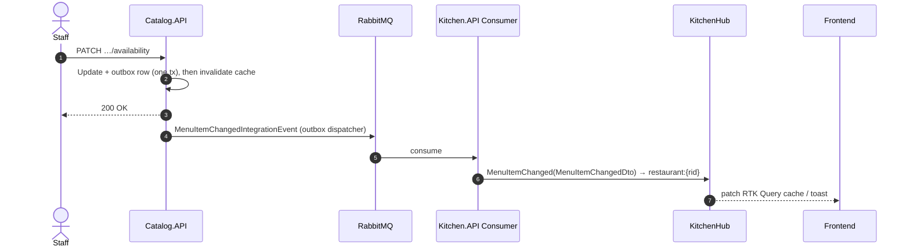

# Menu Management, Availability & Image Storage — Backend Implementation Plan

> Scope: Delivers the operational menu endpoints in `Catalog.API` (`GET /v1/restaurants/{id}/menu` tree reader, `PATCH /v1/restaurants/{id}/menu-items/{id}/availability`), enforces tenant isolation and RBAC permissions (`menu:view`, `menu:toggle`, `menu:edit`), implements an extensible object storage layer (`IBlobStorageService`) backed by Azurite, builds the menu item image upload flow, adds a default-course field for POS routing, and forwards real-time menu events to `KitchenHub` in `Kitchen.API`.

---

## Status

> **Plan version**: `v1.1` (2026-10-31)
> **Current state**: ⏸ Pending review (not started)
> **Depends on**: nothing. **Required by**: `menu_management_ui.md` (Web), `order_creation_pos.md` (Web, `DefaultCourseNumber`).

| Phase | Name | Status |
|:-----:|---|:-----:|
| 1 | Contract Fixes: Menu Tree, Availability PATCH, Event Contract & Default Course | ⏸ Pending |
| 2 | Authorization, Tenant Isolation, Permission Alignment & Contract Inventory | 🔒 Blocked |
| 3 | Extensible Blob Storage Layer (Azurite + provider switch) | 🔒 Blocked |
| 4 | Menu Item Image Upload & Validation Pipeline | 🔒 Blocked |
| 5 | Real-Time Sync via KitchenHub (new Kitchen consumer) | 🔒 Blocked |
| 6 | Verification, Testcontainers & Documentation | 🔒 Blocked |

> **Legend**: ✅ Done · 🚧 In progress · ⏸ Pending · 🔒 Blocked

> **Commit messages**: Conventional Commits (`feat:`, `docs:`, `chore:`, `test:`, `fix:`). Short subject, ≤50 chars, imperative mood, no trailing period. No AI attribution.

> **Update rule**: **on every phase completion, the plan MUST be updated in the same commit as the phase work.**

---

## 0. Skill & documentation conventions

### 0.1 Skill mandate
> All implementation work on this plan MUST follow the **csharp-developer** and **add-catalog-endpoint** skills: Carter Minimal API (`ICarterModule`), MediatR CQRS (`ICommand`/`IQuery`), FluentValidation pipeline behaviors, strict NodaTime (`Instant`, `LocalDate` — never `DateTime`), and primary constructors.

### 0.2 Code-quality guard rails
- **Quality Gate script**: run from `OrderlyMicroservices/` at the end of every phase:
  `pwsh ./scripts/phase-guard.ps1 -PhaseName "<Phase Name>" -Quick`
- **Tenant isolation**: every mutation and tenant-scoped query MUST validate `restaurantId` against the route **and** the caller's JWT `restaurantId`/`restaurantIds` claims, and the item's `RestaurantId`. No cross-tenant access.
- **Transactional Outbox**: all integration events (`MenuItemChangedIntegrationEvent`) are published via `IOutboxPublisher` in the same transaction as the mutation.
- **Provider-agnostic storage**: handlers depend ONLY on `IBlobStorageService` from `BuildingBlocks.Storage`.
- **Nullable reference types** enabled in all new `.cs` files.

---

## 1. Context (verified against code, 2026-10-31)

The frontend page `/site/restaurant/menu` works only against MSW mocks because of these discrepancies in `Catalog.API`:

1. **Missing read route**: `IMenuReader` (`Readers/IMenuReader.cs`) and `CachedMenuReader` (`Caching/`) exist for cache repair but no Carter endpoint exposes the tree.
2. **Broken availability toggle**: the UI sends `{ isAvailable }` to `PUT /v1/menu-items/{id}`, but `UpdateMenuItemRequest` is a full-entity update (requires `Name`, prep times, `ImageUrl`, …) → `400`.
3. **No permission/tenant guards**: no endpoint under `Features/MenuItems`, `MenuItemVariations`, `MenuItemIngredients` or `MenuCategories` calls `RequirePermission`; handlers do not check `item.RestaurantId`. Other Catalog features (Brands, BulkOrderUploads…) use `catalog:menu_update`; Identity seeds `menu:view` / `menu:edit` (`DataSeeder.cs`) but **no `menu:toggle`**.
4. **No storage service**: `MenuItem.ImageUrl` is a plain string; no upload endpoint, blob abstraction or emulator container.
5. **Event already exists but is incomplete**: `MenuItemChangedIntegrationEvent` (`BuildingBlocks.Messaging/Events/Catalog`) is already published by the Create/Update/Delete/Combo/Ingredient handlers, but it carries **no `ImageUrl`** and **Kitchen.API has no consumer for any Catalog event** (its handlers are Order* only).
6. **`PUT` can clobber the image**: `UpdateMenuItemRequest.ImageUrl` is a required string, so a stale edit form would overwrite an uploaded image.
7. **No default course** on menu items, which the POS flow needs for auto-course routing (see `order_creation_and_pos.md`).

---

## 2. Goal

- Expose a cached menu tree `GET /v1/restaurants/{restaurantId}/menu`.
- Dedicated `PATCH /v1/restaurants/{restaurantId}/menu-items/{id}/availability`.
- Secure all menu endpoints with `menu:view` / `menu:toggle` / `menu:edit` and strict tenant boundaries.
- `IBlobStorageService` in `BuildingBlocks` with `AzureBlobStorageService` (Azurite locally); provider switch by configuration, S3 implemented only when needed.
- `POST /v1/restaurants/{restaurantId}/menu-items/{id}/image` with magic-byte + dimension validation.
- Extend `MenuItemChangedIntegrationEvent` additively (`ImageUrl`, `DefaultCourseNumber`) and relay it to `KitchenHub`.
- Add `DefaultCourseNumber` (nullable) to menu items.

---

## 3. Out of scope

- Video uploads; AI moderation / background removal.
- A standalone Catalog SignalR hub (we reuse the authenticated `KitchenHub` `restaurant:{id}` groups).
- Presigned direct-to-storage uploads (server-proxied upload fits the 5 MB limit).
- `S3BlobStorageService` (removed from v1; the `Provider` option exists and an unsupported value fails fast at startup).
- Optimistic-concurrency tokens (`RowVersion`/`If-Match`) on menu items — noted as a follow-up; image clobbering is solved by making `ImageUrl` immutable through `PUT`.

---

## 4. Tech decisions

| Decision | Choice | Reason |
| :--- | :--- | :--- |
| Storage abstraction | `IBlobStorageService` in `BuildingBlocks/Storage` | Decouples handlers from cloud SDKs. |
| Default provider | **Azurite** (dev) / Azure Blob (prod) | Official emulator, Aspire-friendly. |
| Other providers | `BlobStorageOptions.Provider`; `"S3"` throws `NotSupportedException` at startup until implemented | Avoids dead code and an unneeded `AWSSDK.S3` dependency. |
| Availability endpoint | `PATCH` with body `{ "availabilityStatus": "Available" \| "Limited" \| "Unavailable" }`. Server derives `IsAvailable` (`Unavailable` ⇒ `false`; `Available`/`Limited` ⇒ `true`) | One source of truth; no contradictory pairs. |
| Mutation side effects | Shared `MenuItemMutationNotifier` (cache invalidation **after commit** + outbox event) used by new and existing handlers | Removes duplicated code across 8+ handlers. |
| `PUT /v1/menu-items/{id}` | `ImageUrl` is ignored/immutable via PUT; only the image endpoint writes it | Prevents stale forms overwriting uploads. |
| Route shape | New endpoints are restaurant-nested. Legacy routes (`/v1/menu-items/{id}`, …) are **kept** and enforce tenancy via JWT claim + `item.RestaurantId` | Avoids a breaking migration; see §6.4 route table. |
| Permissions | Menu endpoints use `menu:*`. `catalog:menu_update` remains for non-menu Catalog features (Brands, BulkOrderUploads…) | One vocabulary per domain. |
| Real-time delivery | Reuse `KitchenHub` with new `MenuItemChanged(MenuItemChangedDto)` | One SignalR connection on the frontend. |
| Image validation | Magic-byte sniff + `SixLabors.ImageSharp` `Image.IdentifyAsync` (header-only: format + width/height ≤ 8000 px). **No re-encode.** | Rejects disguised files and decompression bombs cheaply. **Licence must be confirmed — see §11.** |
| Image read access | Container with public blob read; `PublicBaseUrl` is environment-specific config (dev: `http://localhost:10000/devstoreaccount1`, browser-reachable via the published port; prod: public bucket/CDN URL) | Simple; no per-request signing. |

---

## 5. Folder layout

```
OrderlyMicroservices/orderly-microservices/
├── docker-compose.yml / docker-compose.override.dev.yml   # azurite (10000)
├── orderly-microservices.AppHost/Program.cs               # Azure Storage emulator
├── BuildingBlocks/Storage/
│   ├── IBlobStorageService.cs
│   ├── BlobStorageOptions.cs
│   ├── AzureBlobStorageService.cs
│   └── DependencyInjection.cs                             # AddBlobStorage(config)
├── BuildingBlocks.Messaging/Events/Catalog/MenuItemChangedIntegrationEvent.cs   # + ImageUrl, DefaultCourseNumber
└── Services/
    ├── Catalog/Catalog.API/
    │   ├── Features/Menu/GetMenu/{GetMenuEndpoint,GetMenuQuery,GetMenuHandler}.cs
    │   ├── Features/MenuItems/
    │   │   ├── PatchMenuItemAvailability/{Endpoint,Handler,Command,Validator}.cs
    │   │   └── UploadMenuItemImage/{Endpoint,Handler,Command,ImageHeaderValidator}.cs
    │   └── Features/MenuItems/Common/MenuItemMutationNotifier.cs
    └── Kitchen/Kitchen.API/
        ├── Application/EventHandlers/Integration/MenuItemChangedIntegrationEventHandler.cs
        └── Hubs/{IKitchenHubClient.cs,KitchenHub.cs}      # + MenuItemChanged, MenuItemChangedDto
```

---

## 6. Specification

### 6.1 `IBlobStorageService`

```csharp
namespace BuildingBlocks.Storage;

public interface IBlobStorageService
{
    Task<Uri> UploadAsync(string containerName, string blobPath, Stream content,
        string contentType, CancellationToken cancellationToken = default);
    Task<bool> DeleteAsync(string containerName, string blobPath,
        CancellationToken cancellationToken = default);
    Task<Stream?> OpenReadAsync(string containerName, string blobPath,
        CancellationToken cancellationToken = default);
    Uri GetBlobUri(string containerName, string blobPath);
}
```

`UploadAsync` returns the public `Uri` (built from `PublicBaseUrl`); the handler stores `uri.ToString()` in `MenuItem.ImageUrl`.

### 6.2 Configuration & provider switch

```csharp
public class BlobStorageOptions
{
    public const string SectionName = "BlobStorage";
    public string Provider { get; set; } = "AzureBlob";          // "AzureBlob" only in v1
    public string ConnectionString { get; set; } = "UseDevelopmentStorage=true";
    public string PublicBaseUrl { get; set; } = string.Empty;    // REQUIRED per environment; startup validation fails if empty
    public string ContainerName { get; set; } = "menu-assets";
}
```

`AddBlobStorage` binds options with `ValidateOnStart()`, registers `AzureBlobStorageService` for `"AzureBlob"` and throws `NotSupportedException` for any other value. The container is auto-created by a hosted initializer (`CreateIfNotExistsAsync(PublicAccessType.Blob)`), not inside the singleton constructor, and failure is reported through health checks.

### 6.3 Event & hub contracts

`MenuItemChangedIntegrationEvent` gains **additive, nullable** members (old in-flight messages still deserialize):

```csharp
public string? ImageUrl { get; init; }
public int? DefaultCourseNumber { get; init; }
```

`ImageUrl`/`DefaultCourseNumber` are `null` on `Deleted`. The Kitchen consumer relays:

```csharp
public sealed record MenuItemChangedDto(
    Guid MenuItemId, Guid RestaurantId, string ChangeType /* Created|Updated|Deleted */,
    string? Name, decimal? BasePrice, bool? IsAvailable, string? AvailabilityStatus,
    string? ImageUrl, int? DefaultCourseNumber, Instant OccurredAt);
```
Hub method: `Task MenuItemChanged(MenuItemChangedDto change)` to group `restaurant:{restaurantId}`.

### 6.4 Endpoint & route table

| Action | Route | Permission | Notes |
|---|---|---|---|
| Read menu tree | `GET /v1/restaurants/{restaurantId:guid}/menu` | `menu:view` | `IMenuReader` (cached) → `MenuSnapshot` incl. `DefaultCourseNumber` |
| Toggle availability | `PATCH /v1/restaurants/{restaurantId:guid}/menu-items/{id:guid}/availability` | `menu:toggle` | body `{ availabilityStatus }`; `200 { success:true }` |
| Upload image | `POST /v1/restaurants/{restaurantId:guid}/menu-items/{id:guid}/image` | `menu:edit` | `multipart/form-data`, field `file`; `200 { imageUrl }` |
| Create/Update/Delete item | legacy `/v1/menu-items[/{id}]` (kept) | `menu:edit` | tenant from JWT + `item.RestaurantId`; `PUT` ignores `ImageUrl`; `DefaultCourseNumber` added to Create/Update |
| Variations, Ingredients, Categories, SubCategories | existing legacy routes (inventoried in Phase 2) | `menu:edit` | tenant check in handlers |
| **New where missing** (from the Web plan's needs) | category delete + reorder (`DisplayOrder`), sub-category CRUD, ingredient list for the picker | `menu:view` / `menu:edit` | created as small slices if the inventory finds them absent |

#### `PATCH …/availability` handler
1. Validate `menuItem.RestaurantId == restaurantId` and `restaurantId ∈ caller's claims` (`404` for not found / foreign item, `403` for claim mismatch).
2. Set `AvailabilityStatus`, derive `IsAvailable`.
3. `SaveChanges` and outbox publish in one transaction (`MenuItemMutationNotifier`).
4. **After commit**: `catalogCache.InvalidateMenuAsync(restaurantId, ct)`.

#### `POST …/image` handler
1. Validate extension (`.jpg/.jpeg/.png/.webp`), size ≤ 5 MB, sniff magic bytes (JPEG `FF D8 FF`, PNG `89 50 4E 47`, WebP `RIFF….WEBP`), then `Image.IdentifyAsync` (format matches sniffed type, width/height ≤ 8000).
2. Verify tenant + item ownership.
3. Path: `restaurants/{restaurantId}/menu-items/{id}/{unixMs}.{ext}`.
4. **Order**: upload new blob → set `ImageUrl` + commit (with outbox event) → invalidate cache → delete previous blob (best-effort; failure logged, never fails the request). If the DB commit fails, the new blob is deleted best-effort; any remaining orphans are removed by the periodic sweep (Phase 4).
5. Endpoint is registered with `.DisableAntiforgery()` (JWT API, no cookies) and `RequestSizeLimit`/`RequestFormLimits` ≈ 6 MB.

---

## 7. Cross-service flow



---

## 8. Security guardrails

> [!CAUTION]
> Always validate that `id` belongs to `restaurantId` AND that `restaurantId` is one of the caller's JWT restaurants. Never operate by item ID alone.

| Risk | Mitigation |
|---|---|
| Cross-tenant manipulation | Route `{restaurantId}` + JWT claim check + `item.RestaurantId` check in every handler. |
| Malicious upload / decompression bomb | 5 MB limit, extension + magic-byte + header-only dimension check, whitelist of content types. |
| Unauthorized price edits | `menu:edit` only; `menu:toggle` can only change `availabilityStatus`. |
| Stale cache | Invalidate after commit; drift repair sweep every 5 min. |
| Public blob guessing | Paths contain tenant + item GUIDs + timestamp; no listing allowed. |
| KitchenHub fallback group | `KitchenHub` joins an unclaimed connection to a hard-coded default restaurant group. Replace with "reject the connection" (tracked in Phase 5 since menu events broadcast there). |

---

## 9. Development Phases

### Phase 1 — Contract Fixes: Menu Tree, Availability PATCH, Event Contract & Default Course
**Goal**: The real backend supports menu queries, 86'd updates and carries the data downstream clients need.
**Status**: ⏸ Pending

**Deliverables**:
- [ ] `Features/Menu/GetMenu/*` mounting `GET /v1/restaurants/{restaurantId:guid}/menu` via `IMenuReader` (cached); snapshot includes `DefaultCourseNumber`.
- [ ] `MenuItemMutationNotifier` (post-commit cache invalidation + outbox `MenuItemChangedIntegrationEvent`); refactor existing Create/Update/Delete handlers to use it.
- [ ] `Features/MenuItems/PatchMenuItemAvailability/*` with the invariant in §4 (validator rejects unknown status).
- [ ] Extend `MenuItemChangedIntegrationEvent` with nullable `ImageUrl`, `DefaultCourseNumber` (additive).
- [ ] Add `MenuItem.DefaultCourseNumber` (`int?`, 1–9) with EF migration; add to Create/Update requests, validators and the snapshot.
- [ ] `UpdateMenuItem`: ignore/remove `ImageUrl` handling.
- [ ] Unit tests: validator, handler (invariant, tenant mismatch, event content), notifier.

**Exit criteria** (from `OrderlyMicroservices/`):
```powershell
pwsh ./scripts/phase-guard.ps1 -PhaseName "Phase 1 - Menu Endpoints" -Quick
```

---

### Phase 2 — Authorization, Tenant Isolation, Permission Alignment & Contract Inventory
**Status**: 🔒 Blocked

**Deliverables**:
- [ ] **Contract inventory**: list the real routes of MenuItems, Variations, Ingredients, Categories, SubCategories; fill the §6.4 table; create missing slices (category delete/reorder, sub-category CRUD, ingredient list).
- [ ] Seed `menu:toggle` in `Identity.API/Data/DataSeeder.cs`; keep `menu:view`/`menu:edit` names.
- [ ] Assign `menu:view` to all 7 restaurant-zone roles; `menu:toggle` to SuperAdmin, RestaurantAdmin, Manager, KitchenManager; `menu:edit` to SuperAdmin, RestaurantAdmin, Manager.
- [ ] Add `.RequirePermission("menu:…")` to every MenuItems, Variations, Ingredients, Categories, SubCategories endpoint (replacing `catalog:menu_update` on menu routes only).
- [ ] Tenant validation helper (route + JWT claims + entity) used in all handlers.
- [ ] Update `docs/architecture/permissions.md`; tell the Web repo the final names (its `types/auth.ts` must match).

**Exit criteria**: `pwsh ./scripts/phase-guard.ps1 -PhaseName "Phase 2 - Menu Permissions" -Quick`

---

### Phase 3 — Extensible Blob Storage Layer
**Status**: 🔒 Blocked

**Deliverables**:
- [ ] Azurite container in `docker-compose.yml` / `docker-compose.override.dev.yml` (port 10000) and AppHost resource.
- [ ] `IBlobStorageService`, `BlobStorageOptions` (with `ValidateOnStart`), `AzureBlobStorageService` (`Azure.Storage.Blobs`), `AddBlobStorage` (unsupported provider → startup failure).
- [ ] Container initializer hosted service + health check.
- [ ] Integration test (Azurite Testcontainer): upload / read / delete.

**Exit criteria**: `pwsh ./scripts/phase-guard.ps1 -PhaseName "Phase 3 - Blob Storage" -Quick`

---

### Phase 4 — Menu Item Image Upload & Validation Pipeline
**Status**: 🔒 Blocked

**Deliverables**:
- [ ] `Features/MenuItems/UploadMenuItemImage/*` per §6.4 (antiforgery disabled, size limits).
- [ ] `ImageHeaderValidator` (magic bytes) + `Image.IdentifyAsync` dimension/format check.
- [ ] Upload → commit → delete-previous ordering; best-effort cleanup; hosted sweep removing blobs under `restaurants/*/menu-items/*` not referenced by any `ImageUrl` and older than 24 h.
- [ ] YARP: confirm `/catalog-api/{**}` forwards multipart up to the limit (Kestrel `MaxRequestBodySize`) with a test through the gateway.
- [ ] Publish `MenuItemChangedIntegrationEvent` with `ImageUrl`.

**Exit criteria**: `pwsh ./scripts/phase-guard.ps1 -PhaseName "Phase 4 - Image Upload" -Quick`

---

### Phase 5 — Real-Time Sync via KitchenHub
**Status**: 🔒 Blocked

**Deliverables**:
- [ ] `MenuItemChangedDto` + `IKitchenHubClient.MenuItemChanged`.
- [ ] `MenuItemChangedIntegrationEventHandler` in `Kitchen.API/Application/EventHandlers/Integration/` (new MassTransit consumer + endpoint registration in `Kitchen.API/Program.cs`; no Kitchen DB changes).
- [ ] Relay to `restaurant:{RestaurantId}`; consumer is idempotent (broadcast only).
- [ ] `KitchenHub.OnConnectedAsync`: reject connections without a restaurant claim instead of joining the hard-coded default group (update affected tests).
- [ ] Consumer unit test + hub broadcast test.

**Exit criteria**: `pwsh ./scripts/phase-guard.ps1 -PhaseName "Phase 5 - KitchenHub Integration" -Quick`

---

### Phase 6 — Verification, Testcontainers & Documentation
**Status**: 🔒 Blocked

**Deliverables**:
- [ ] Integration tests in `Catalog.API.Tests`: GetMenu, PatchAvailability, UploadImage.
- [ ] **Negative tests**: foreign-restaurant item (404/403), each role vs permission matrix, invalid magic bytes, oversize file, oversize dimensions, invalid availability value, `PUT` not altering `ImageUrl`.
- [ ] `dotnet test` full suite; update `docs/architecture` (permissions, events, storage).
- [ ] `pwsh ./scripts/phase-guard.ps1 -PhaseName "Phase 6 - Verification" -Quick`

---

## 10. Technical considerations

- **Azurite container** is created by the initializer service (see §6.2), not on first request.
- **YARP**: `/catalog-api/{**catch-all}` must allow multipart bodies up to the endpoint limit (~6 MB form).
- **Cache invalidation** happens after the transaction commits.
- **Event versioning**: only additive nullable fields are allowed on `MenuItemChangedIntegrationEvent`.

---

## 11. Open decisions (need owner confirmation before Phase 4)

1. **ImageSharp licence** (Six Labors Split License): confirm it is acceptable for this project; otherwise replace `Image.IdentifyAsync` with a hand-rolled header parser.
2. **Legacy routes kept** vs migrating to nested routes (plan assumes kept).
3. **Image hosting in production** (public bucket vs CDN) → determines `PublicBaseUrl`.

---

## Changelog

### v1.1 (2026-10-31) — review fixes
- Context verified against code: event already exists (added `ImageUrl`, `DefaultCourseNumber`), Kitchen has no Catalog consumer, `menu:toggle` unseeded.
- Availability PATCH now accepts `availabilityStatus` only; `IsAvailable` derived (invariant).
- `PUT` no longer writes `ImageUrl`; `MenuItemMutationNotifier` shared helper; invalidation after commit.
- Route table + contract inventory; missing category/sub-category/ingredient slices.
- Storage: `UploadAsync` returns `Uri`; `S3BlobStorageService` removed; `PublicBaseUrl` env-specific + validated; container initializer + health check; antiforgery disabled; orphan-blob handling and sweep; dimension checks.
- Added `DefaultCourseNumber` (POS dependency), `KitchenHub` default-group hardening, expanded Phase 6 negative tests, explicit event/DTO contracts, working directory for phase guard.

### v1.0 (2026-10-31) — initial draft
- Created plan covering Phases 1–6.
