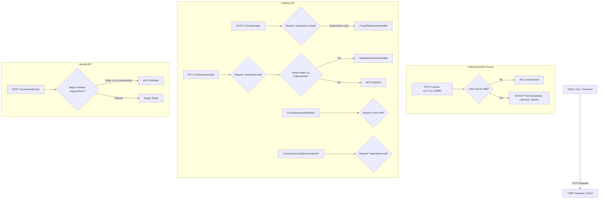

# Restaurant Lifecycle & DevMCP Security Hardening — Implementation Plan

> Scope: Hardens tenant creation boundaries, closes RBAC escalation gaps in Catalog and Identity, adds authentication to exposed Catalog endpoints, and locks down DevMCP server listener and host exposure.

---

## Status

> **Plan version**: `v1.0` (2026-11-06) — initial plan drafted after security audit.
> **Current state**: ⏸ Not started

| Phase | Name | Status |
|:-----:|---|:-----:|
| 1 | DevMCP Transport Hardening & Secret Guard | ⏸ Pending |
| 2 | Restaurant Lifecycle RBAC & Tenant Boundary Isolation | ⏸ Pending |
| 3 | Identity.API Privilege Escalation & Role Assignment Guard | ⏸ Pending |
| 4 | Catalog Tables, Floorplan & Reservations Authorization | ⏸ Pending |
| 5 | Cross-Service Verification & Security Test Suite | ⏸ Pending |

> **Legend**: ✅ Done · 🚧 In progress · ⏸ Pending · 🔒 Blocked

> **Commit messages**: Conventional Commits (`feat:`, `docs:`, `chore:`, `test:`, `fix:`). Short subject, ≤50 chars, imperative mood, no trailing period. Never include AI attribution.

---

## 0. Skill & documentation conventions

### 0.1 Skill mandate
> **All backend C# implementation work on this plan MUST follow `csharp-developer` (.NET 10 Minimal APIs, Carter modules, MediatR CQRS, and explicit type annotations). All DevMCP TypeScript work MUST follow strict TypeScript and Zod schema validations.**

### 0.2 Code-quality guard rails
- **Quality Gate script**: Run `pwsh ./scripts/phase-guard.ps1 -Quick` or relevant dotnet/pnpm test passes.
- **Fail-closed security**: Unauthenticated or unauthorized requests must always return 401 Unauthorized or 403 Forbidden with zero information leakage.
- **Tenant Isolation**: Non-SuperAdmin operations must enforce `currentUser.RestaurantId == targetRestaurantId`.

---

## 1. Context

A comprehensive security audit revealed several critical vulnerabilities and design discrepancies across tenant lifecycle management and developer tooling:

1. **Over-permissioned Tenant Creation**: `CreateRestaurantEndpoint` in `Catalog.API` uses `.RequirePermission("catalog:menu_update")`. Any operational user with menu editing privileges could create new tenant restaurants or delete existing restaurants.
2. **Missing Permission Seeds**: `catalog:menu_update` was never seeded into `Identity.API`'s `Permissions` table, meaning no real user could ever receive this claim through normal OpenIddict authentication.
3. **Horizontal Privilege Escalation (IDOR)**: `UpdateRestaurantCommandHandler` and `DeleteRestaurantCommandHandler` do not verify whether the authenticated caller owns the target restaurant.
4. **DevMCP Unauthenticated HTTP Transport**: `Orderly.DevMCP.Server` default-bound to `0.0.0.0:8080` and accepted any incoming JSON-RPC HTTP request without authentication or header checks.
5. **Anonymous Catalog Features**: `Tables` (Create, Update, Delete), `MergedTables`, `Reservations` (Confirm, Seat, Cancel), and `WalkInQueues` had zero authorization decorators and were completely public.
6. **Vertical Privilege Escalation in Identity**: `RestaurantAdmin` held `users:assign_roles`, and `AssignRolesCommandHandler` lacked role hierarchy validation, allowing self-escalation to `SuperAdmin`.

---

## 2. Goal

1. **Isolate Restaurant Creation**: Restrict restaurant creation and deletion strictly to `SuperAdmin` using distinct `restaurants:create` and `restaurants:delete` permissions.
2. **Enforce Tenant Boundaries on Updates**: Restrict `restaurants:edit` to `SuperAdmin` or `RestaurantAdmin` scoped strictly to their assigned `restaurantId`.
3. **Lock Down DevMCP Transport**: Default `HOST` to `127.0.0.1` and enforce a secret header (`x-dev-secret: DEV_TRIGGER_SECRET`) on all incoming HTTP requests.
4. **Close Privilege Escalation in Identity**: Prevent non-`SuperAdmin` callers from granting `SuperAdmin` roles or modifying `SuperAdmin` permissions.
5. **Protect Anonymous Catalog Endpoints**: Apply `menu:edit` / `reservations:edit` / `reservations:view` to all Table, Floorplan, and Reservation endpoints in `Catalog.API`.
6. **Sync Central Permission Catalog**: Update `docs/architecture/permissions.md` and seed tables in `Identity.API/Data/DataSeeder.cs`.

---

## 3. Out of scope

- Production cloud deployments (AWS/Azure/GCP IAM roles).
- Client-side frontend changes (OrderlyWeb already gates routes by role).
- Modifying customer-facing anonymous menu browsing (GET `/menu` and GET `/restaurants` intentionally remain public).

---

## 4. Tech decisions

| Decision | Choice | Reason |
|---|---|---|
| **Restaurant Provisioning Permission** | Separate `restaurants:create`, `restaurants:edit`, `restaurants:delete` | Decouples root tenant provisioning from operational menu editing. Only `SuperAdmin` gets `restaurants:create` and `restaurants:delete`. |
| **DevMCP HTTP Authentication** | Header `x-dev-secret` matching `DEV_TRIGGER_SECRET` | Lightweight, fail-fast shared secret protection preventing unauthorized network clients from executing MCP tools. |
| **DevMCP Default Interface** | `127.0.0.1` (loopback only) | Prevents listening on all network interfaces (`0.0.0.0`) by default. |
| **Identity Role Hierarchy** | Restrict `SuperAdmin` assignment in handler | Prevents `RestaurantAdmin` (who can assign roles to restaurant staff) from escalating accounts to platform `SuperAdmin`. |
| **Catalog Tables Authorization** | Gate on `menu:edit` (write) / `menu:view` (read) | Tables and floorplans are part of restaurant layout configuration managed by restaurant managers and admins. |

---

## 5. System diagram

---

## 6. Detailed Phase Breakdown

### Phase 1: DevMCP Transport Hardening & Secret Guard
- In `Orderly.DevMCP.Server/src/config/env.ts`:
  - Change `HOST` default from `0.0.0.0` to `127.0.0.1`.
  - Add optional/required `DEV_TRIGGER_SECRET` with fallback in development.
- In `Orderly.DevMCP.Server/src/index.ts`:
  - Add authentication middleware before `activeTransport.handleRequest(req, res)`.
  - Check header `x-dev-secret` (or Authorization Bearer). If invalid, return HTTP `401 Unauthorized`.
- In `Orderly.DevMCP.Server/test/support/mcp-client.ts` and wire tests:
  - Add `x-dev-secret` header in test clients.

### Phase 2: Restaurant Lifecycle RBAC & Tenant Boundary Isolation
- In `docs/architecture/permissions.md`:
  - Document `restaurants:create`, `restaurants:edit`, `restaurants:delete`.
- In `Identity.API/Data/DataSeeder.cs`:
  - Add `restaurants:create`, `restaurants:edit`, `restaurants:delete`, and `catalog:menu_update` to `SeedPermissionsAsync`.
  - Map `restaurants:create` and `restaurants:delete` ONLY to `SuperAdmin`.
  - Map `restaurants:edit` to `SuperAdmin` and `RestaurantAdmin`.
- In `Catalog.API`:
  - Change `CreateRestaurantEndpoint` to `.RequirePermission("restaurants:create")`.
  - Change `DeleteRestaurantEndpoint` to `.RequirePermission("restaurants:delete")`.
  - Change `UpdateRestaurantEndpoint` to `.RequirePermission("restaurants:edit")`.
  - In `UpdateRestaurantHandler`: Verify caller belongs to the restaurant (`currentUser.RestaurantId == command.Id`) or has `SuperAdmin` role.

### Phase 3: Identity.API Privilege Escalation & Role Assignment Guard
- In `Identity.API/Features/Users/AssignRoles/AssignRolesCommand.cs`:
  - Inspect `command.Roles` for `"SuperAdmin"`.
  - If requested and current user does not have the `SuperAdmin` role, throw `ForbiddenAccessException` or return 403 Forbidden.
- In `Identity.API/Features/Roles/AssignPermissions/AssignPermissionsCommand.cs`:
  - Protect `SuperAdmin` role from permission alterations by non-`SuperAdmin` users.

### Phase 4: Catalog Tables, Floorplan & Reservations Authorization
- In `Catalog.API/Features/Tables/`:
  - Add `.RequirePermission("menu:edit")` to `CreateTable`, `UpdateTable`, `DeleteTable`.
  - Add `.RequirePermission("menu:view")` to `GetTables` and `GetTableById`.
- In `Catalog.API/Features/MergedTables/`:
  - Add `.RequirePermission("menu:edit")` to merge/unmerge endpoints.
- In `Catalog.API/Features/Reservations/`:
  - Add `.RequirePermission("reservations:edit")` to `ConfirmReservation`, `SeatReservation`, `CancelReservation`.
  - Add `.RequirePermission("reservations:view")` to `GetReservations`, `GetReservationById`.
- In `Catalog.API/Features/WalkInQueues/`:
  - Add `.RequirePermission("reservations:edit")` to queue management endpoints.

### Phase 5: Cross-Service Verification & Security Test Suite
- Run `Catalog.API.Tests`:
  - Verify `CatalogAuthorizationEnforcementTests.cs` passes with updated permissions.
  - Add test asserting 403 when non-SuperAdmin calls `CreateRestaurant`.
  - Add test asserting 403 when unauthenticated caller hits table/reservation endpoints.
- Run `Orderly.DevMCP.Server` test suite:
  - Run `pnpm typecheck` and `pnpm test`.
  - Verify wire tests pass with auth header.

---

## 7. Plan Verification Checklists

### Phase 1 Check
- [ ] DevMCP refuses connections missing `x-dev-secret`.
- [ ] DevMCP defaults to `127.0.0.1`.

### Phase 2 Check
- [ ] Non-SuperAdmin cannot create or delete restaurants.
- [ ] RestaurantAdmin cannot update another restaurant's configuration.

### Phase 3 Check
- [ ] RestaurantAdmin cannot assign `SuperAdmin` role to any account.

### Phase 4 Check
- [ ] Anonymous clients receive 401 on Table and Reservation mutation routes.

### Phase 5 Check
- [ ] All automated tests pass across Catalog.API, Identity.API, and DevMCP.
