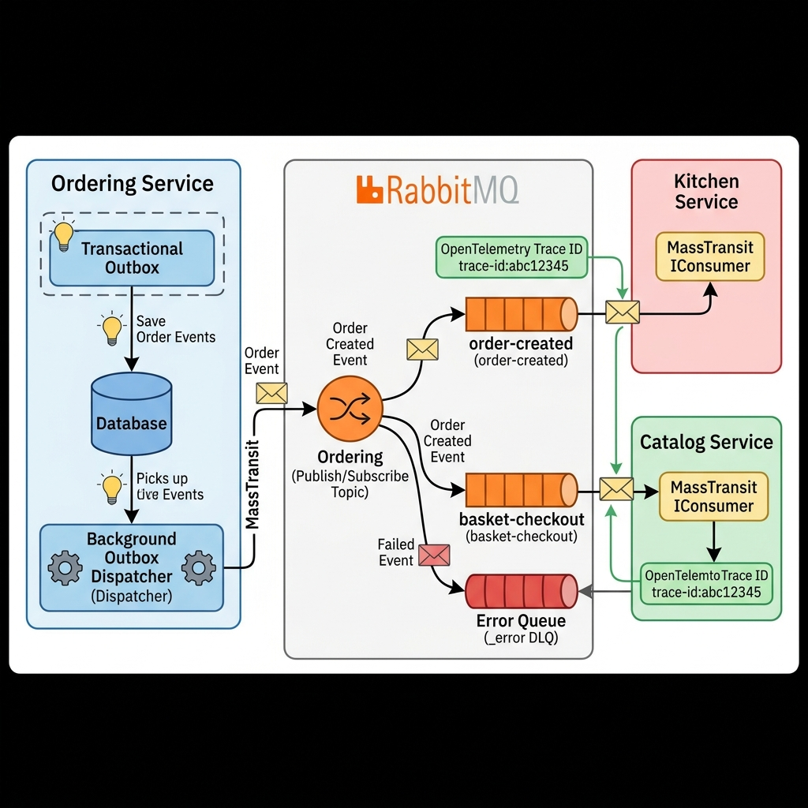
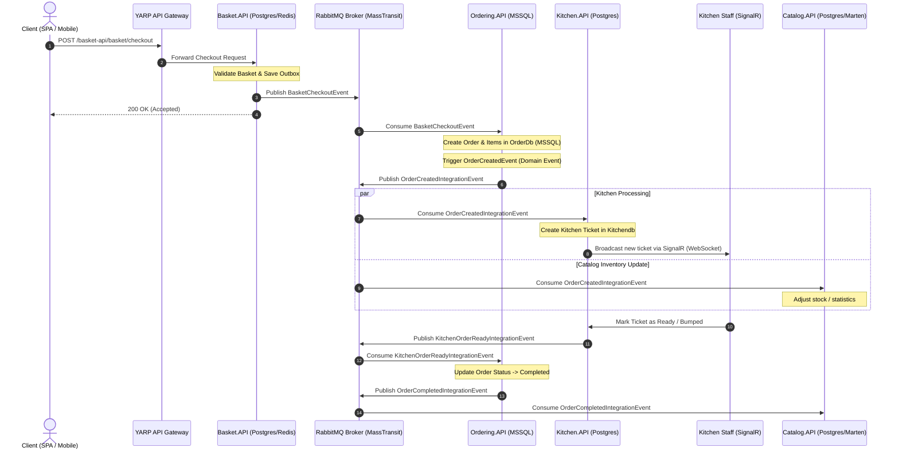

# MassTransit & Asynchronous Messaging Technical Guide

## 1. Overview & Architecture

In **OrderlyMicroservices**, microservices interact across network boundaries using asynchronous message-based communication. Instead of direct synchronous HTTP coupling between backend services, services publish **Integration Events** over an AMQP message broker (**RabbitMQ**), mediated by **MassTransit**.

### Why Asynchronous Messaging?
- **Decoupling**: Services do not need to know the network topology, IP addresses, or endpoints of other microservices.
- **Resilience**: If a downstream service (e.g., Kitchen API) is temporarily offline or restarting, messages wait safely in RabbitMQ queues without failing client HTTP requests.
- **Scalability**: Multiple instances of a consuming service can process messages from the same queue concurrently (competing consumers pattern).

---

## 2. MassTransit Architecture & Component Flow



| Component | Description | Code / Repo Reference |
| :--- | :--- | :--- |
| **Integration Event** | An immutable record representing a domain fact that other bounded contexts care about. | `BasketCheckoutEvent`, `OrderCreatedIntegrationEvent` |
| **MassTransit** | A high-level .NET message bus framework managing connections, serialization, retries, and conventions. | Package: `MassTransit.RabbitMQ` |
| **RabbitMQ** | The AMQP message broker running in the `messagebroker` container (Port `5672`, Mgmt UI `15672`). | Image: `rabbitmq:3-management` |
| **Publisher** | A service that produces and publishes an event to an exchange. | Injected via `IPublishEndpoint` |
| **Consumer** | A class implementing `IConsumer<TIntegrationEvent>` to handle incoming messages. | E.g., `OrderCreatedIntegrationEventHandler` |
| **Dead-Letter Queue (DLQ)** | An error queue automatically created by MassTransit (`<queue-name>_error`) for unhandled failures. | Automatic fallback after retry exhaustion |

---

## 3. End-to-End Order Flow Across Microservices

Here is the complete journey of an Order moving across the codebase, from user checkout through the API Gateway, message broker, order persistence, kitchen ticket dispatching, real-time SignalR notifications, and completion.



---

## 4. How MassTransit is Configured

### Shared Registration Extension
All services wire up MassTransit through the shared helper in `BuildingBlocks.Messaging`:
- File: [`BuildingBlocks.Messaging/MassTransit/Extensions.cs`](file:///c:/Users/omar_/Source/Repos/kalaa/orderly/OrderlyMicroservices/orderly-microservices/BuildingBlocks.Messaging/MassTransit/Extensions.cs)

```csharp
public static IServiceCollection AddMessageBroker(
    this IServiceCollection services, 
    IConfiguration configuration, 
    Assembly? assembly = null)
{
    // Validates MessageBroker:Host, UserName, Password
    services.AddMassTransit(config =>
    {
        // 1. Enforces consistent kebab-case naming for all endpoints/queues
        config.SetKebabCaseEndpointNameFormatter();

        // 2. Automatically scans and registers all IConsumer<T> types in the specified assembly
        if (assembly is not null)
        {
            config.AddConsumers(assembly);
        }

        // 3. Configures RabbitMQ transport and binds endpoints
        config.UsingRabbitMq((context, configurator) =>
        {
            configurator.Host(new Uri(host), hostCfg =>
            {
                hostCfg.Username(userName);
                hostCfg.Password(password);
            });

            configurator.ConfigureEndpoints(context);
        });
    });

    return services;
}
```

---

## 5. Message Flow Lifecycle & Code Examples

### 1. Publishing an Event
When a business operation completes (e.g. within an in-process MediatR domain event handler), the producer publishes an integration event via `IPublishEndpoint`:

```csharp
public class OrderCreatedEventHandler(IPublishEndpoint publishEndpoint, ILogger<OrderCreatedEventHandler> logger)
    : INotificationHandler<OrderCreatedEvent>
{
    public async Task Handle(OrderCreatedEvent notification, CancellationToken cancellationToken)
    {
        OrderCreatedIntegrationEvent integrationEvent = notification.Order.ToOrderCreatedIntegrationEvent();
        await publishEndpoint.Publish(integrationEvent, cancellationToken);
    }
}
```

### 2. RabbitMQ Exchange & Queue Topology
- MassTransit declares a **Fanout / Topic Exchange** named after the integration event message type (e.g., `BuildingBlocks.Messaging.Events:OrderCreatedIntegrationEvent`).
- For each consumer registered in a service, MassTransit declares a **Queue** named with kebab-case conventions (e.g., `order-created-integration-event` or `order-created-kitchen-handler`) and binds it to the exchange.

### 3. Consuming an Event
When RabbitMQ delivers the message to the queue, MassTransit invokes the consumer's `Consume` method within a scoped dependency injection container:

```csharp
public class OrderCreatedIntegrationEventHandler(
    ISender sender, 
    ILogger<OrderCreatedIntegrationEventHandler> logger) 
    : IConsumer<OrderCreatedIntegrationEvent>
{
    public async Task Consume(ConsumeContext<OrderCreatedIntegrationEvent> context)
    {
        OrderCreatedIntegrationEvent message = context.Message;
        logger.LogInformation("Integration event received: {OrderId}", message.OrderId);

        // Dispatches command into internal Clean Architecture / MediatR pipeline
        await sender.Send(new CreateKitchenTicketCommand(message), context.CancellationToken);
    }
}
```

---

## 6. The Transactional Outbox Pattern

To prevent the **Dual-Write Problem** (where a database transaction commits, but the application crashes before publishing the event to RabbitMQ):

1. **Storage**: Instead of publishing directly to RabbitMQ, events can be persisted as rows in an `OutboxMessages` database table inside the *same database transaction* as the business entity.
2. **Dispatching**: A background hosted service ([`OutboxDispatcher.cs`](file:///c:/Users/omar_/Source/Repos/kalaa/orderly/OrderlyMicroservices/orderly-microservices/BuildingBlocks.Messaging/Outbox/OutboxDispatcher.cs)) continuously polls unpublished rows in batches.
3. **Publishing**: The dispatcher publishes the messages using `IPublishEndpoint` to RabbitMQ.
4. **Completion**: Upon successful publish, the outbox record is stamped with `ProcessedOn` (or moved to `OutboxDeadMessages` if unrecoverable).

---

## 7. How to Inspect & Monitor Messages

### A. RabbitMQ Management Web UI
- **URL**: [http://localhost:15672](http://localhost:15672)
- **Default Credentials**: `guest` / `guest`
- **What to check**:
  - **Exchanges tab**: Verify that your integration event exchanges exist.
  - **Queues tab**: Check message counts (`Ready`, `Unacked`, `Total`).
  - **Inspect Payloads**: Click into a queue -> Expand **Get messages** -> Click **Get Message(s)** to view the serialized JSON body and MassTransit message headers.

### B. Command-Line Queue Inspection
Run the following command to check queue depths directly from Docker:
```bash
docker exec -it messagebroker rabbitmqctl list_queues name messages consumers
```

### C. Troubleshooting & Error Queues (`_error`)
If a consumer throws an unhandled exception:
1. MassTransit retries the message according to configured retry policies.
2. If retries are exhausted, the message is automatically moved to `<queue-name>_error`.
3. The message headers in the `_error` queue contain:
   - `MT-Fault-Message`: The exception error message.
   - `MT-Fault-StackTrace`: The full C# stack trace.

---

## 8. Distributed Tracing with OpenTelemetry

MassTransit integrates out of the box with OpenTelemetry (`BuildingBlocks.Observability`):
- When a message is published, MassTransit injects the W3C `traceparent` header into the message envelope.
- When the consumer reads the message, it extracts the trace context and starts a child span.
- This allows end-to-end tracing across services in Jaeger/OpenTelemetry:
  `Yarp Gateway -> Ordering.API -> RabbitMQ -> Kitchen.API`.

---

## 9. Testing Messaging Code

### Integration Tests with Testcontainers
Integration test suites (such as in `Basket.API.Tests` and `Discount.Grpc.Tests`) spin up real, isolated RabbitMQ containers using Testcontainers:
```csharp
private readonly RabbitMqContainer _rabbit = new RabbitMqBuilder()
    .WithImage("rabbitmq:3-management")
    .Build();
```

### MassTransit In-Memory Test Harness
For fast component-level testing without Docker containers:
```csharp
services.AddMassTransitTestHarness(cfg =>
{
    cfg.AddConsumer<OrderCreatedIntegrationEventHandler>();
});
```
Test assertions can verify if a message was consumed or published:
```csharp
Assert.True(await harness.Consumed.Any<OrderCreatedIntegrationEvent>());
```
